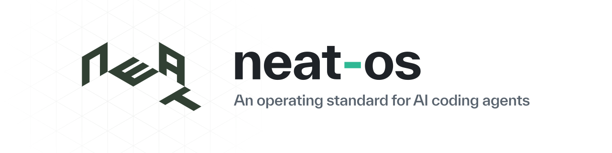
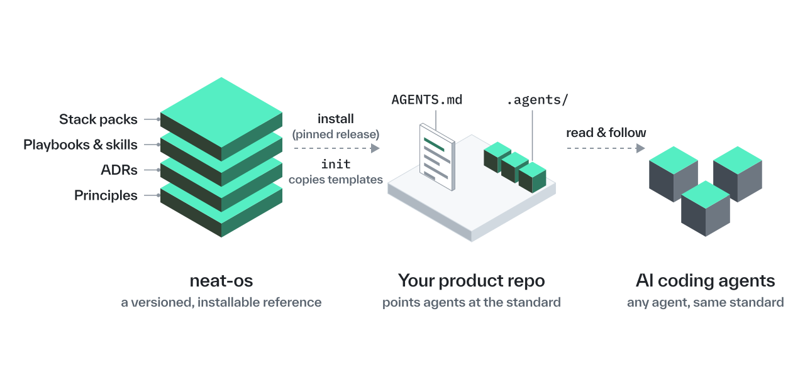
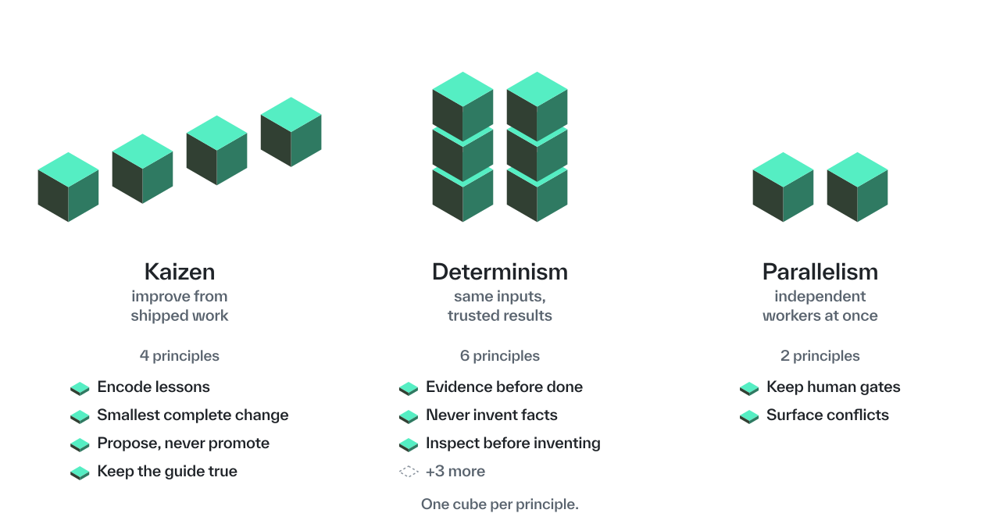
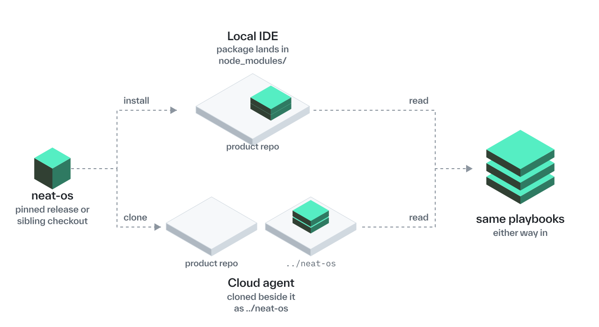
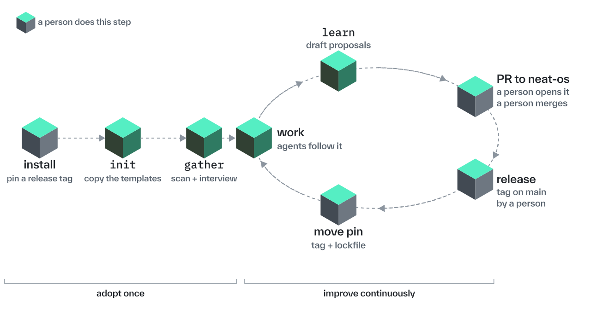
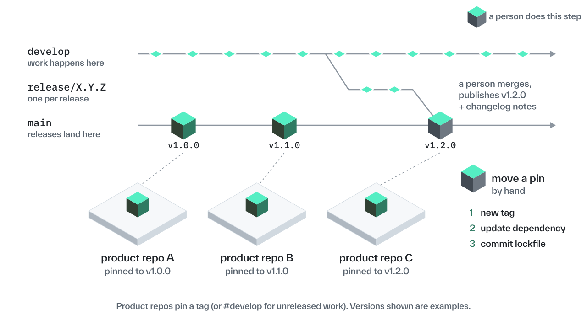

<p align="center">
  <picture>
    <source media="(prefers-color-scheme: dark)" srcset="docs/assets/readme/banner-b-lockup-wordmark-dark.svg">
    <source media="(prefers-color-scheme: light)" srcset="docs/assets/readme/banner-b-lockup-wordmark-light.svg">
    
  </picture>
</p>

# neat-os

neat-os is the shared knowledge that Shed's AI agents work from. It is an operating standard: the fixed set of rules and procedures the agents run on, whichever project they are working in. It is a git repository that every Shed product repository installs. It holds the principles agents apply while deciding, the engineering conventions every Shed repo shares, the playbooks, the template files those playbooks copy, the ADRs that record why a locked behaviour exists, and the stack packs under [`stacks/`](stacks/). Everything lives in this repository so a Cursor Cloud Agent can read it with a git checkout and nothing else.

`init` leaves an empty stack-pack slot. `gather` points a product repo at the matching pack. Tool-specific knowledge will live in separate `neat-os-tool-*` repositories later. They are not part of this one. Together with neat-os they are the OS repos. Everything else at Shed is a product repo.

It is also the agency rulebook for shared operations playbooks. Living operational state stays in a private operations repository; the rules and playbooks stay here ([docs/agency-ops.md](docs/agency-ops.md)).

## How it fits together

A product repository pins a neat-os release. `init` copies templates into `AGENTS.md` and an `.agents/` folder. Agents read those files and follow them. The package itself stays in the install (`node_modules/` or a sibling checkout). It is not copied in as those files.

<p align="center">
  <picture>
    <source media="(prefers-color-scheme: dark)" srcset="docs/assets/readme/diagram-how-it-fits-dark.svg">
    <source media="(prefers-color-scheme: light)" srcset="docs/assets/readme/diagram-how-it-fits-light.svg">
    
  </picture>
</p>

## Goals

<p align="center">
  <picture>
    <source media="(prefers-color-scheme: dark)" srcset="docs/assets/readme/concept-1-three-goals-dark.svg">
    <source media="(prefers-color-scheme: light)" srcset="docs/assets/readme/concept-1-three-goals-light.svg">
    
  </picture>
</p>

| Goal | Meaning |
| --- | --- |
| [Kaizen](principles/kaizen.md) | Improve the system from shipped work, in small steps |
| [Determinism](principles/determinism.md) | The same inputs give tested, trusted results |
| [Parallelism](principles/parallelism.md) | Independent workers, including Cloud Agents, can run at once |

Each goal has a few one-line principles beneath it. The index is [principles/README.md](principles/README.md).

## Building blocks

<p align="center">
  <picture>
    <source media="(prefers-color-scheme: dark)" srcset="docs/assets/readme/concept-2-building-blocks-dark.svg">
    <source media="(prefers-color-scheme: light)" srcset="docs/assets/readme/concept-2-building-blocks-light.svg">
    
  </picture>
</p>

The six kinds of mechanism are defined in [schema/README.md](schema/README.md). Project knowledge lives in the product repository. Decisions live as ADRs. Reviewer agents are not in the tree yet.

## Two ways in

<p align="center">
  <picture>
    <source media="(prefers-color-scheme: dark)" srcset="docs/assets/readme/concept-4-two-ways-in-dark.svg">
    <source media="(prefers-color-scheme: light)" srcset="docs/assets/readme/concept-4-two-ways-in-light.svg">
    
  </picture>
</p>

Pin a release tag (`#vX.Y.Z`) for a product repository. `#develop` is for unreleased work. How a release happens is in [docs/release.md](docs/release.md). First install, moving an existing install, and moving from shed-os are in [docs/consume.md](docs/consume.md), and nowhere else.

### On your computer, in the Cursor IDE

1. In the product repository root, add the dependency to `package.json` and run `npm install`. If `@shedcollective/neat-os` is already in `package-lock.json`, use the move steps in [docs/consume.md](docs/consume.md) instead:

   ```json
   "@shedcollective/neat-os": "git+ssh://git@github.com/shedcollective/neat-os.git#vX.Y.Z"
   ```

   The package lands in `node_modules/@shedcollective/neat-os`. A PHP project adds the Node dependency too. The Composer package carries metadata only.

2. Open the repository in Cursor and ask the agent to run the first two playbooks. Give it the client and product so `gather` can finish:

   ```text
   Follow node_modules/@shedcollective/neat-os/skills/init/SKILL.md, then
   node_modules/@shedcollective/neat-os/skills/gather/SKILL.md.
   Client: Acme. Product: the marketing WordPress site.
   ```

3. You should see `AGENTS.md` and an `.agents/` folder in the repository, with Client and Product filled in `.agents/project.md`.

### In a Cloud Agent

1. Ask a team admin for a Cloud Agent Environment that contains the product repository and `shedcollective/neat-os`. Why both are needed is explained in [docs/cursor-environments.md](docs/cursor-environments.md).
2. Start the agent from that Environment. neat-os is cloned beside the product repository as `../neat-os`, and the playbooks find it there. `SHED_OS_ROOT` and a sibling named `../shed-os` still resolve, and each prints a deprecation warning.
3. Prompt as in the computer steps, with the path `../neat-os/skills/init/SKILL.md`. Include the client and product in the prompt. A Cloud Agent cannot interview you, so without them `gather` stops and reports itself incomplete.

## Adoption and the improvement loop

<p align="center">
  <picture>
    <source media="(prefers-color-scheme: dark)" srcset="docs/assets/readme/concept-3-adoption-loop-dark.svg">
    <source media="(prefers-color-scheme: light)" srcset="docs/assets/readme/concept-3-adoption-loop-light.svg">
    
  </picture>
</p>

Adopt once: a person pins a release, then runs `init`, then `gather`. After that, agents follow the files while they work. `learn` drafts proposals. A person opens the pull request that would elevate one, and a person merges it. A person tags a release on `main`. Each product repository moves its own pin. A release does not flow back into product repositories on its own.

## The playbooks

- `init` creates the `AGENTS.md` and `.agents/` files in a product repository from the templates. It leaves every placeholder empty.
- `gather` fills those files from evidence in the repository, then interviews you for what the tree cannot show, starting with the client and the product. It is not finished until those two are real answers.
- `learn` reads recent commits and merges and drafts proposals for what could become a shared principle or playbook. It never publishes them. A person opens that pull request.
- `ticket` creates a Jira Task from a brief, or enhances an existing one, in the shape and tone the client can read ([conventions/ticket-content.md](conventions/ticket-content.md)). It writes to Jira only, never to the repository.
- `assurance` reads one pull request against its ticket and posts an evidence pack. It does not implement, push, approve, or merge.
- `pin-majors-with-reasons` upgrades dependencies by blast radius and does not take a pinned major on a routine bump.

`init`, `gather`, `learn`, and `ticket` are described in [docs/launch-skills.md](docs/launch-skills.md). Agency operations playbooks (`daily-burndown`, `enhance-daily-update`, `project-update`, `client-brief`, `meeting-prep`, `daily-digest`, `morning-brief`, `bids-register`, `finance-client-backfill`, `finance-client-sync`, `finance-lookup`) are mapped in [docs/agency-ops.md](docs/agency-ops.md). Design playbooks (`design-brief`, `mockup`, `brand-from-site`, `brand-board-from-assets`, `naming-and-voice`, `design-handoff`), the assurance playbook `design-qa`, and UX playbooks (`ux-audit`, `research-synthesis`, `wireframes`) follow [conventions/design-ux-agents.md](conventions/design-ux-agents.md). All playbooks are under [skills/](skills/).

`daily-digest` turns the day file into a short end-of-day post for a team channel. `morning-brief` composes one morning message per person and replaces separate morning health, digest, day-plan, and meeting-prep brief messages. Agency operations playbooks take their inputs from the settings in [conventions/routine-settings.md](conventions/routine-settings.md).

## Releases and pinning

<p align="center">
  <picture>
    <source media="(prefers-color-scheme: dark)" srcset="docs/assets/readme/concept-5-releases-pinning-dark.svg">
    <source media="(prefers-color-scheme: light)" srcset="docs/assets/readme/concept-5-releases-pinning-light.svg">
    
  </picture>
</p>

Work lands on `develop`. A release-prep pull request sets the version. Prepare release opens `release/X.Y.Z` into `main` and a draft Release. A person merges that pull request with a merge commit and publishes the draft. Product repositories pin that tag. `#develop` is for unreleased work. Several product repositories can sit on different tags. A person moves a pin by changing the tag, updating the dependency, and committing the lockfile. Node runs `npm update`. Composer runs `composer update`. The steps are in [docs/release.md](docs/release.md) and [docs/consume.md](docs/consume.md).

### Working on neat-os itself

1. Clone `shedcollective/neat-os`. You need Node 22 and bash. There is nothing to install.
2. Run `bash scripts/check`. It is the same command CI runs, and `npm test` is an alias for it.
3. Read the "Working in this checkout" section of [AGENTS.md](AGENTS.md#working-in-this-checkout), then [docs/contributing.md](docs/contributing.md).

## Documentation

| Page | What it covers |
| --- | --- |
| [docs/README.md](docs/README.md) | Where documentation lives and the full map |
| [docs/consume.md](docs/consume.md) | Installing neat-os in a product repository, moving an existing install, and moving from shed-os |
| [docs/launch-skills.md](docs/launch-skills.md) | What `init`, `gather`, `learn`, and `ticket` do, and where `assurance` and `pin-majors-with-reasons` live |
| [docs/cursor-environments.md](docs/cursor-environments.md) | The GitHub App, Cloud Agent Environments, and how they differ |
| [docs/team-setup.md](docs/team-setup.md) | Cursor and GitHub administration for the team |
| [docs/release.md](docs/release.md) | How neat-os is released on `shedcollective/neat-os` |
| [CHANGELOG.md](CHANGELOG.md) | What changed in each version, including the move from shed-os |
| [docs/faq.md](docs/faq.md) | Problems we have hit and their fixes |
| [docs/contributing.md](docs/contributing.md) | How to change neat-os |
| [docs/decisions/](docs/decisions/README.md) | Why locked behaviour is the way it is |

Agents working in this repository read [AGENTS.md](AGENTS.md). The six kinds of mechanism that make up neat-os (principle, convention, playbook, skill, script, agent) are defined in [schema/README.md](schema/README.md). How pages are written is locked in [conventions/writing.md](conventions/writing.md).

## What neat-os does not do

- Agents do not install from GitHub Packages. An agent token gets a 403 from the registry. Agents install from a git pin (`github:shedcollective/neat-os#vX.Y.Z`) and need no registry token. The registry install for a product repository is in [docs/consume.md](docs/consume.md) ([ADR-0019](docs/decisions/0019-publish-github-packages.md)). The licence is MIT.
- `init` does not copy skills into a product repository's `.agents/skills/`. Agents read them from the installed package.
- Agents do not search the public web for how to install neat-os. The resolve order in [docs/consume.md](docs/consume.md) is the only way an agent looks for it.
- The archive tag `v0.0.1` predates a root `package.json` and cannot be installed. It is not a neat-os release. Do not pin it.
